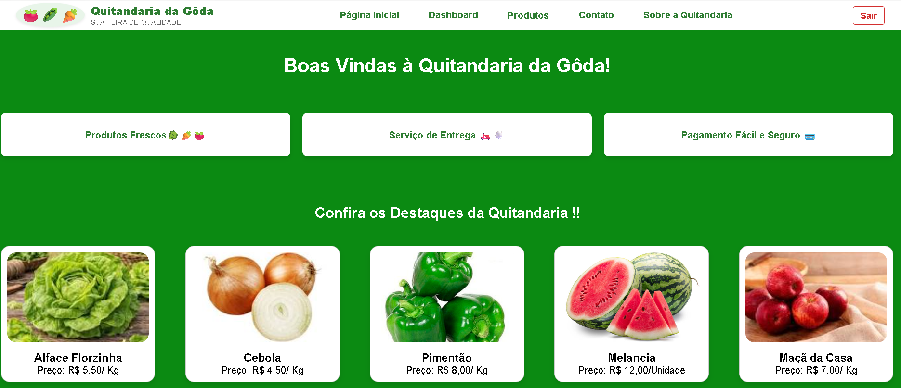
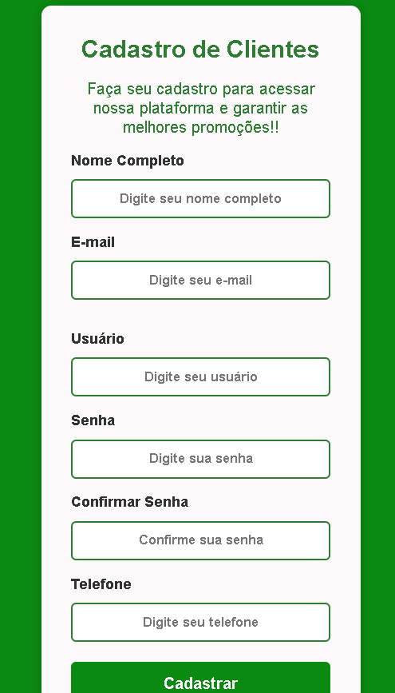

# Manual do Usuário — Quitandaria da  Goda

Bem-vindo ao manual do usuário do sistema da **Quitandaria da Goda**. Aqui você encontra instruções simples para navegar pelo site, criar sua conta, consultar produtos e entrar em contato com a nossa equipe.

---

## 1. Como navegar pela Página Inicial e conhecer a Quitandaria

Ao acessar o site da Quitandaria Godá, você encontra os principais atalhos no menu superior para explorar nossos produtos e serviços.

1. Acesse a **Página Inicial** (`index.php`).
2. Utilize o menu de navegação no topo da tela para escolher entre **Produtos**, **Sobre Nós**, **Contato** ou **Entrar**.
3. Caso queira conhecer a história e a missão da quitandaria, clique em **Sobre Nós** (`sobre.php`).

---

## 2. Como criar uma conta (Cadastro)

Para realizar pedidos e acompanhar suas compras pelo painel, é necessário criar um cadastro gratuito.

1. No menu principal ou na tela de login, clique na opção **Cadastrar** (`cadastro.php`).
2. Preencha os campos obrigatórios do formulário: **Nome completo**, **E-mail**, **Telefone com DDD**, **Endereço de entrega** e crie uma **Senha** segura. *(O campo CPF é opcional)*.
3. Confira se o seu e-mail está digitado corretamente.
4. Clique no botão **Cadastrar** para finalizar. Após o envio, você será direcionado para a tela de acesso.

---

## 3. Como entrar no sistema e acessar o Painel

Se você já possui cadastro, siga os passos abaixo para entrar na sua área restrita:

1. Clique em **Login** (`login.php`) no menu superior.
2. Digite o **E-mail** e a **Senha** cadastrados.
3. Clique em **Entrar**.
4. Você será levado ao **Painel do Usuário (Dashboard)** (`dashboard.php`), onde poderá visualizar seus dados e gerenciar suas ações no sistema.

> **Esqueceu sua senha?** Na própria tela de login, clique em *"Esqueci minha senha"* (`esqueceu_senha.php`), informe seu e-mail cadastrado e siga as instruções enviadas para redefinir o acesso.

---

## 4. Como consultar os Produtos disponíveis

Você pode conferir as frutas, verduras e legumes frescos disponíveis na quitandaria a qualquer momento:

1. No menu superior, clique em **Produtos** (`produtos.php`).
2. Navegue pela lista para visualizar o nome, a categoria e o preço de cada item disponível.
3. Utilize os filtros ou categorias (quando disponíveis) para encontrar rapidamente o que procura.

---

## 5. Como entrar em contato com a Quitandaria

Precisa tirar alguma dúvida sobre entregas, horários de funcionamento ou disponibilidade de itens?

1. Clique em **Contato** (`contatos.php`) no menu principal.
2. Preencha seu **Nome**, **E-mail** e escreva sua **Mensagem** no campo indicado.
3. Clique em **Enviar** e aguarde o retorno da nossa equipe pelo e-mail informado.

---

## 6. Perguntas Frequentes (FAQ)

* **Preciso pagar alguma taxa para me cadastrar no site?**
  Não. O cadastro na Quitandaria Godá é totalmente gratuito.

* **O preenchimento do CPF no cadastro é obrigatório?**
  Não. Você pode concluir seu cadastro informando apenas nome, e-mail, telefone e endereço.

* **Não consigo entrar na minha conta. O que devo fazer?**
  Verifique se o *Caps Lock* (tecla de letras maiúsculas) do seu teclado está ativado ao digitar a senha. Se ainda assim não conseguir acessar, clique em **Esqueci minha senha** na tela de login para criar uma nova.

* **Como atualizo meu endereço de entrega?**
  Acesse sua conta na tela de **Login**, entre no seu **Painel (Dashboard)** e edite suas informações cadastrais.
